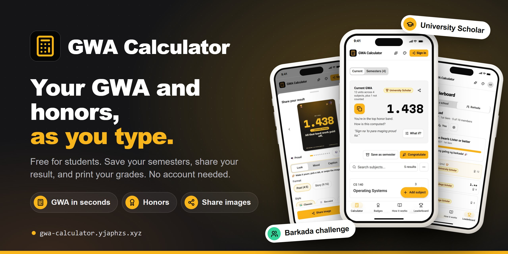
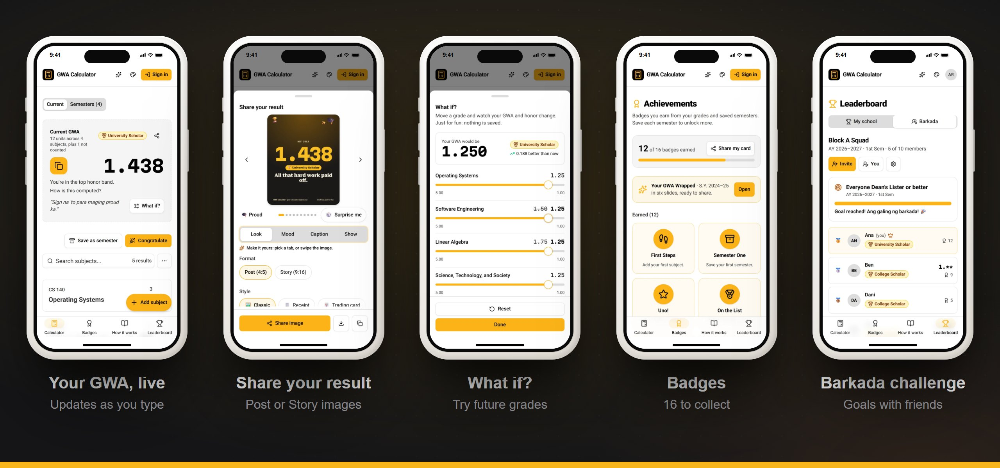

<p align="center">
  <a href="https://gwa-calculator.yjaphzs.xyz">
    
  </a>
</p>

<h1 align="center">GWA Calculator</h1>

<p align="center">
  <b>Work out your General Weighted Average (GWA) and see your academic honors as you type.</b><br />
  Free · No account needed · Works on your phone and computer
</p>

<p align="center">
  <a href="https://gwa-calculator.yjaphzs.xyz"><b>Open GWA Calculator</b></a>
  &nbsp;·&nbsp;
  <a href="https://gwa-calculator.yjaphzs.xyz/how-to-compute-gwa">How to compute your GWA</a>
  &nbsp;·&nbsp;
  <a href="https://app-hub.yjaphzs.xyz">More apps</a>
</p>

---

## At a glance

- **What it is:** a free website that works out your GWA from your subjects, grades, and units.
- **Who it's for:** students who want to check their GWA and honor standing on their own.
- **What you need:** a phone or computer with a web browser. Nothing to install, and no sign-up.
- **Where your data goes:** it stays in your browser unless you choose to sign in.
- **Good to know:** results are for your own reference. Your school's registrar keeps the official record.

## Get started in 4 steps

1. **Open** [gwa-calculator.yjaphzs.xyz](https://gwa-calculator.yjaphzs.xyz).
2. **Add a subject:** tap **Add subject**, then enter the course code, title, grade, and units.
3. **Read your GWA:** it updates as you type. Once you have at least 12 units, your honor shows too (for example, Dean's Lister).
4. **Save the semester** when you're done: tap **Save as semester**. Your cumulative GWA and Latin honors build up from there.

> [!TIP]
> Sign in with your email or Google account to keep your grades safe and see them on all your devices.

## What you can do

### Work out your GWA
- Your GWA updates as you type, to 3 decimal places.
- See your semester honor: University Scholar, College Scholar, or Dean's Lister ([bands below](#honors-at-a-glance)).
- Leave out subjects that don't count, such as NSTP, or mark a subject INC, DRP, W, or IP (in progress).
- New to GWA? The [guide](https://gwa-calculator.yjaphzs.xyz/how-to-compute-gwa) explains the formula with a worked example.

### Keep your semesters
- Save each semester and follow your cumulative GWA and Latin honors.
- Add or remove subjects in a saved semester later.
- Plan ahead: see the GWA you need next semester to reach a Latin honor.
- Try **What if?** sliders to see how other grades would change your GWA. Nothing is saved.

### Share and celebrate
- Make **share images** for posts and stories, in different moods and styles, with captions in English or Taglish.
- You decide what shows. By default it's only your GWA and honor, and you can hide the exact number (it shows as **1.\*\***).
- Collect **16 badges**, and get a cheer when you beat last semester.
- **GWA Wrapped:** turn a school year into six story slides.

### Compare with friends (optional, needs sign-in)
- **Barkada challenge:** make a group of up to 10, share an invite link, and set a goal such as "everyone Dean's Lister or better". Groups rank by honors and badges, never by exact grades, and your GWA stays hidden unless you choose to show it.
- **School leaderboard:** join from your account to appear on your school's board.

### Print and move your data
- Print or save as PDF a **Semester Report** or an **Academic Summary**. Both are marked as a personal copy.
- Move your data to another device with a **QR code**, or back it up to a file.

### Make it yours
- Light mode, dark mode, or match your device.
- Color schemes: Amber, Pink, Red, Green, Teal, Blue, Purple, Black, or any color you pick.

## See it in action

<p align="center">
  
</p>

## Honors at a glance

**Semester honors** (need at least 12 units that count):

| Honor | GWA |
|---|---|
| University Scholar | 1.00–1.50 |
| College Scholar | above 1.50, up to 1.75 |
| Dean's Lister | above 1.75, up to 2.00 |

**Latin honors** (from your cumulative GWA):

| Honor | GWA |
|---|---|
| Summa Cum Laude | 1.00–1.20 |
| Magna Cum Laude | above 1.20, up to 1.45 |
| Cum Laude | above 1.45, up to 1.75 |

> [!NOTE]
> Schools set their own rules. These are the bands the app uses, so check yours with your registrar.

## Your data and privacy

- **Without an account:** everything stays in this browser on this device. Clearing your browser data erases it, so back it up with a QR code or a file, or sign in.
- **With an account:** your grades are saved to your account and stay in step on all your devices.
- **Sharing is your choice:** share images, barkadas, and the leaderboard only show what you pick.
- **You're in control:** delete your account and its data at any time from the **Account** page.
- Read the full [Privacy Policy](https://gwa-calculator.yjaphzs.xyz/privacy-policy) and [Terms and Conditions](https://gwa-calculator.yjaphzs.xyz/terms-and-conditions).

## Questions

<details>
<summary><b>Is it free?</b></summary>

Yes. Every feature is free, and you don't need an account to use the calculator.
</details>

<details>
<summary><b>Is the GWA here my official grade?</b></summary>

No. It's a personal tool to help you check and plan. Your school's registrar has the official record, and printed reports say "Personal copy".
</details>

<details>
<summary><b>A subject isn't counted. Why?</b></summary>

It's set to not count (for example, NSTP), or it's marked INC, DRP, W, or IP. Those stay on your list, but their grade and units are left out of your GWA.
</details>

<details>
<summary><b>Why don't I see an honor?</b></summary>

Semester honors need at least 12 units that count, and a GWA within one of the bands above.
</details>

<details>
<summary><b>How do I move my grades to a new phone?</b></summary>

Sign in on both devices, or use the QR code transfer or a backup file from the menu.
</details>

<details>
<summary><b>I found a problem or have an idea.</b></summary>

Email [jan@yjaphzs.xyz](mailto:jan@yjaphzs.xyz) or [open an issue](https://github.com/yjaphzs/gwa-calculator/issues).
</details>

## Support

If the calculator helps you, you can [buy me a Ko-fi](https://ko-fi.com/yjaphzs). Thank you!

---

<details>
<summary><b>For developers</b></summary>

### Tech stack

- **Next.js** App Router, exported as a static site (`output: 'export'`)
- **Firebase:** Hosting, Authentication, Firestore, Storage, and Cloud Functions
- **Tailwind CSS v4** + **shadcn/ui**
- Deeper docs: [architecture](docs/architecture.md), [conventions](docs/conventions.md), [design system](docs/design-system.md)

### Getting started

1. **Clone and install:**
   ```bash
   git clone https://github.com/yjaphzs/gwa-calculator.git
   cd gwa-calculator
   npm install
   ```

2. **Create a Firebase project** and a Web App in the [Firebase Console](https://console.firebase.google.com/), then enable:
   - **Authentication** → Sign-in methods: **Email/Password** and **Google**
   - **Firestore Database**
   - **Storage**
   - (optional) **App Check** with reCAPTCHA v3

3. **Configure environment variables:**
   ```bash
   cp .env.local.example .env.local
   # fill in the NEXT_PUBLIC_FIREBASE_* values from your Web App config
   ```

4. **Configure the email sender (Cloud Functions + Resend).** Verification and password reset
   emails are sent as branded HTML by Cloud Functions via
   [Resend](https://resend.com/docs/send-with-nodejs). The functions generate the action link and
   point it at the in-app `/auth/action` page, so the Firebase console action URL stays as is.
   Add your domain in Resend, add the DKIM/SPF records it shows you, then create an API key.
   For local emulator testing:
   ```bash
   cp functions/.env.example functions/.env
   # fill in RESEND_API_KEY, EMAIL_FROM_EMAIL (e.g. no-reply@yjaphzs.xyz), APP_URL
   ```
   The email HTML is built from the `.hbs` sources in `functions/src/lib/email/templates/` with
   `npm run generate:emails`.

5. **Run the dev server:** `npm run dev`

6. **Check and build:**
   ```bash
   npm run lint && npm run typecheck && npm test
   npm run build   # static export in ./out
   ```

### Local Firebase emulators (optional)

```bash
npm install -g firebase-tools
firebase emulators:start   # Auth, Firestore, Storage, Functions, Hosting
```

### Deployment

Pushing to **`main`** runs [`.github/workflows/deploy.yml`](.github/workflows/deploy.yml): lint,
typecheck, and tests, then the static export, then **Functions → Hosting → Firestore indexes →
Firestore rules → Storage rules** to the single Firebase project. Pushes to `development` run the
checks only.

GitHub repository configuration:

- **Variables** (`Settings → Secrets and variables → Actions → Variables`): every `NEXT_PUBLIC_*`
  value (app and Firebase). `NEXT_PUBLIC_FIREBASE_PROJECT_ID` also selects the deploy target.
  For email: `EMAIL_FROM_NAME`, `EMAIL_FROM_EMAIL`.
- **Secrets:** `GOOGLE_APPLICATION_CREDENTIALS_BASE64` (a base64-encoded Firebase service-account
  JSON key with deploy permissions) and `RESEND_API_KEY`.

The custom domain (`gwa-calculator.yjaphzs.xyz`) is set under Firebase Hosting → Custom domains.

### References

- **Ko-fi button:** [CostasAK/react-kofi-button](https://github.com/CostasAK/react-kofi-button)
- **Copy button, fireworks background, and hooks:** [shadcn.io](https://www.shadcn.io/)
- **Theme switcher:** [shadcnuikit](https://shadcnuikit.com/)

</details>

## License

MIT. Made with ❤️ by [JPB](https://www.yjaphzs.xyz/), with Next.js and shadcn/ui.
